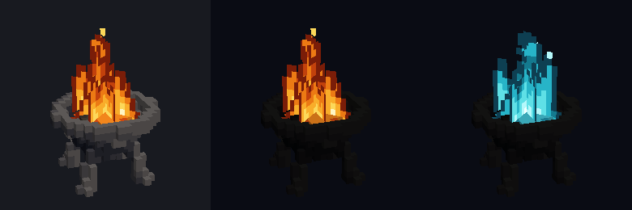
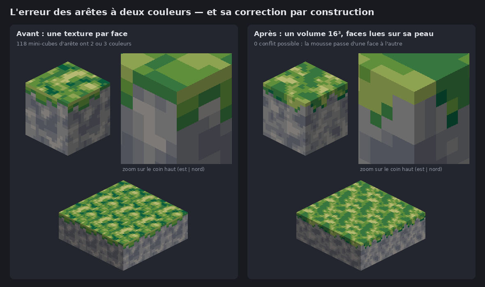
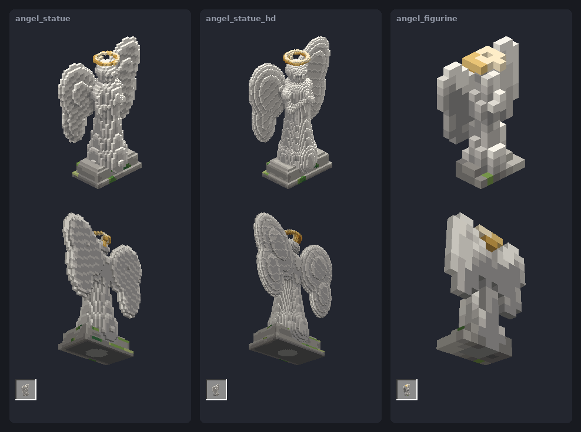
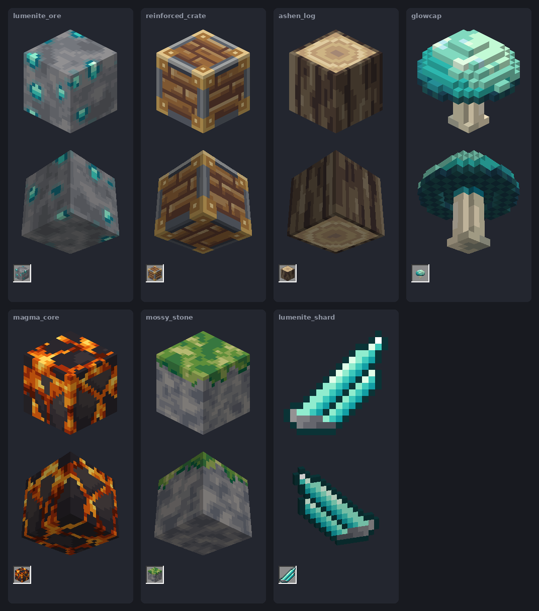

# pixvox

**Atelier pixel-art / voxel-art pour Minecraft Java, piloté par code.** On décrit un bloc, un modèle,
une statue de plusieurs blocs ou un item en Python ; pixvox le **rend comme le jeu**, l'**analyse**,
puis l'**exporte** en resource pack vérifié pixel par pixel, ou en **mod Fabric / NeoForge** compilé.
Conçu pour être utilisé par un agent (Claude, Codex…), un humain ou un autre logiciel.

[](https://github.com/nicolas-goyon/PixVox/actions/workflows/ci.yml)


[](LICENSE)

> **In English:** pixvox is a code-driven pixel/voxel art workshop for Minecraft Java. Describe assets
> in Python, render them like the game does, get an analysis, export a resource pack verified by
> re-rendering, or a compiled Fabric/NeoForge mod. Every command has a stable `--json` output and exit
> codes for agents and CI; a reusable GitHub Action and a Docker image are provided. Docs are in French.



## Pourquoi « voxel d'abord »

Dessiner un bloc face par face crée l'erreur classique : le mini-cube posé sur une arête appartient à
deux faces, et chaque texture lui donne une couleur différente. pixvox renverse la logique : un bloc est
un **volume de voxels** et chaque texture est **lue sur la peau du volume**, avec exactement
l'orientation UV de Minecraft. Un voxel d'arête n'a qu'une couleur : le problème disparaît par
construction.



## Ce que sait faire pixvox

- **Blocs pleins, modèles libres, objets de plusieurs blocs** (statue de 3 × 3,5 blocs), items 16×16.
- **Résolution libre** : décrire l'objet une fois en unités de conception, puis le produire à 16, 32 ou
  64 voxels par bloc, ou à une autre taille (la statue devient une figurine d'un bloc).
- **Animations** : textures animées (`.png.mcmeta`), braises qui palpitent, lave qui coule, flammes
  pixel-art générées, parties lumineuses (`light_emission`) visibles la nuit.
- **Planches de revue** : inventaire, dessous en perspective, monde 3×3×3, nuit, taille réelle, patron
  des textures, analyse (raccords, palette, boucle d'animation…), GIF.
- **Export vérifié** : chaque modèle et chaque texture écrits sur disque sont relus et rendus comme le
  jeu, sous 6 angles plus 2 vues de nuit, puis à chaque image d'animation ; 0 pixel d'écart attendu.
- **Deux familles de versions** : Minecraft 1.21.4 → 26.3 (défaut) ou 1.21.1 avec `--mc 1.21.1`
  (NeoForge 21.1 : `models/item`, lumière en `neoforge_data`, `render_type`) ; la vérification porte sur
  les fichiers de la version visée.
- **Mods Minecraft 26.3** (Fabric ou NeoForge) : vrais blocs avec collision calculée depuis les voxels,
  lumière, particules, orientation, multiblocs posés d'un coup, tables de butin, test JUnit.



## Installation

```bash
pip install "pixvox @ git+https://github.com/nicolas-goyon/PixVox"   # Python ≥ 3.10 (numpy, Pillow)
pixvox doctor                                                        # vérifie tout, dit si les mods sont compilables
```

Autres façons : `docker run --rm -v "$PWD:/work" ghcr.io/nicolas-goyon/pixvox …` (avec JDK 25 pour les
mods), ou depuis un clone : `pip install -e ".[dev]"`. Compiler un mod demande un JDK 25 et l'accès
réseau à Maven.

## Démarrage rapide

```bash
pixvox new mon_minerai --kind block      # fichier de départ commenté (block, model, multiblock, item, animated)
pixvox review mon_minerai.py             # planche out/mon_minerai.review.png + rapport
pixvox export mon_minerai.py --zip out/pack.zip            # resource pack vérifié
pixvox mod mon_minerai.py --modid mon_mod --build          # mod Fabric compilé (--loader neoforge)
```

Un fichier d'asset est un script Python :

```python
from pixvox import Block, Volume, ramp

def build():
    v = Volume(16)                                       # 16³ voxels = un bloc
    v.noise(ramp("#7b7d83", n=4), cells=3, octaves=3, seed=1)
    v.blobs(ramp("#3cc8bb", n=5), count=5, seed=4, on_edges=1)   # cristaux, dont un à cheval sur une arête
    return Block("mon_minerai", v)
```

Tester en jeu sans mod (1.21.4+) : copier le pack dans `resourcepacks/`, puis
`/give @s minecraft:stone[minecraft:item_model="pixvox:mon_minerai"]`. En 1.21.1 (`--mc 1.21.1`) : les
modèles sont portés par le papier, `/give @s minecraft:paper[minecraft:custom_model_data=N]` (N pour
chaque asset dans `README_pixvox.txt` du pack). Avec le mod : le `.jar` dans `mods/` (et Fabric API pour
Fabric).

## Pour les agents et les logiciels

| besoin | où |
|---|---|
| consignes pour travailler sur le dépôt | [`AGENTS.md`](AGENTS.md) (lu par Claude Code via `CLAUDE.md`) |
| skill pour Claude (claude.ai) | `pixvox_skill.zip` de chaque [release](https://github.com/nicolas-goyon/PixVox/releases), mode d'emploi [`SKILL.md`](SKILL.md) |
| skill pour Claude Code, dans n'importe quel projet | `/plugin marketplace add nicolas-goyon/PixVox` puis `/plugin install pixvox@pixvox` |
| résultat exploitable sans lire du texte | `--json` sur toutes les commandes : [contrat et codes de sortie](docs/cli.md) |
| CI d'un autre dépôt | action `uses: nicolas-goyon/PixVox@main` (ou un tag de version) : [intégration](docs/integration.md) |
| sans Python sur la machine | image Docker `ghcr.io/nicolas-goyon/pixvox` |

Codes de sortie : `0` réussi, `1` vérification échouée (écart de rendu, asset refusé, compilation
ratée), `2` erreur d'utilisation ou d'environnement, `3` erreur interne.

## Commandes

| commande | rôle |
|---|---|
| `pixvox new NOM --kind …` | fichier d'asset de départ |
| `pixvox review F.py` | planche PNG + rapport (+ planche d'animation et GIF) |
| `pixvox export F.py… --pack D --zip Z [--mc 1.21.1]` | resource pack vérifié (+ datapack de placement des multiblocs) ; `--mc 1.21.1` pour NeoForge 1.21.1 |
| `pixvox mod F.py… --modid ID [--loader neoforge] --build` | projet de mod + `.jar` |
| `pixvox view F.py --yaw 135 --pitch 20 [--persp 2] [--shading night] [--tick 6]` | angle libre |
| `pixvox anim F.py` / `compare F.py…` / `ascii F.py --face north` | animation, variantes, pixels exacts |
| `pixvox render-model PACK ns:block/nom [--mc 1.21.1]` | aperçu d'un modèle JSON quelconque (pack fait main, Blockbench), lu comme la version choisie |
| `pixvox doctor` / `summary result.json` | diagnostic / résumé Markdown d'un résultat `--json` |

## Exemples

| fichier | démontre |
|---|---|
| `examples/lumenite_ore.py` | minerai 3D, cristaux sur une arête, lueur |
| `examples/reinforced_crate.py` | planches peintes + cadre métallique cohérent sur les 12 arêtes |
| `examples/mossy_stone.py` | avant / après : textures dessinées à part (conflits) vs mousse en voxels |
| `examples/ashen_log.py` | cernes + écorce, blockstate `axis` |
| `examples/glowcap.py` | modèle voxel libre → éléments + atlas |
| `examples/lumenite_shard.py` | item 16×16 dessiné en ASCII |
| `examples/angel_statue.py` | statue 3 × 3,5 × 1 blocs en 16 et 32 voxels par bloc + figurine |
| `examples/brazier.py` | brasero animé : braises lumineuses, feu sur 4 plans, variante des âmes |
| `examples/magma_core.py` | bloc plein animé : lave qui coule dans les joints |
| `examples/copper_lantern.py` | modèle libre lumineux : cage en cuivre patiné, cœur `emission` 15 |



## Limites

- Java Edition uniquement (pas Bedrock) ; resource packs pour 1.21.4 → 26.3 ou 1.21.1, mods pour
  Minecraft 26.3 (versions dans `pixvox/mod.py`).
- Seules les textures s'animent (limite du jeu) ; pas de tintes de biome ni de textures connectées.
- L'ombrage d'inventaire est une approximation fidèle, pas le rendu OpenGL du jeu.
- pixvox ne lance jamais Minecraft : tester en jeu reste une étape humaine.

## Contribuer

Voir [`CONTRIBUTING.md`](CONTRIBUTING.md) : installation de développement, tests, pile de PR, CI et
publication des versions (possible entièrement depuis le site GitHub). Les assets proposés en PR sont
rendus et vérifiés automatiquement.

## Licence

[MIT](LICENSE) © 2026 Nicolas Goyon. Pas un produit officiel Minecraft : ni approuvé par Mojang ou
Microsoft, ni associé à eux.
